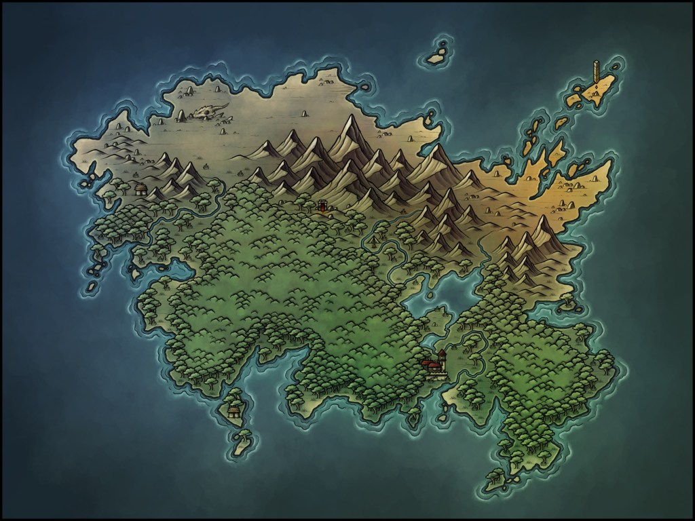

# Peta dan terrain

Gambar dari user, dipakai sebagai **acuan layout** benua EMPIRE.

## Isi gambar
- Satu benua besar, pantai berlekuk, dikelilingi laut biru-hijau gelap.
- **Utara**: dataran pasir pucat, batu-batu kecil, kerangka/tulang naga di barat laut.
- **Pegunungan** diagonal dari tengah-utara ke timur, puncak bersalju tipis.
- **Timur laut**: gurun oranye, gugusan pulau kecil, menara/obelisk di pulau paling ujung.
- **Barat dan selatan**: hutan lebat (pohon bulat hijau).
- **Teluk/danau** di tengah-tenggara memisahkan hutan barat dan hutan timur.
- Sungai berkelok dari pegunungan ke laut.
- Bangunan: gubuk di barat laut, menara merah di kaki gunung tengah, kastil di pantai teluk, kuil kecil di pulau barat daya.

## Rencana teknis (F1)
1. **Mask biome dari gambar.** Skala gambar ke grid 128×128, klasifikasi warna per piksel: air (biru), pasir (krem), gurun (oranye), hutan (hijau), gunung (abu-coklat dengan bayangan). Simpan sebagai `assets/biome-mask.png` atau JSON. Hasilnya dirapikan manual (bangunan dan label dihapus).
2. **Heightmap.** Ketinggian dasar per biome + noise: air -1, pantai 0, dataran 0,3, hutan 0,5, gunung 2–6 dengan punggungan mengikuti garis gunung di mask.
3. **Mesh.** Plane 160×160 m, 96×96 segmen (sama prototipe), warna vertex per biome, flat shading.
4. **Sungai dan jembatan.** Kurva sungai digambar tangan dari gambar, jembatan di 3–4 titik.
5. **Dekorasi.** Pohon low-poly (pinus, ek, palem dari prototipe) di-scatter sesuai mask, InstancedMesh.
6. **Peta spawn.** Dari mask: sel boleh-bangun = bukan air, bukan gunung, bukan sungai, kemiringan < 0,35. Disimpan sebagai daftar sel untuk sampling acak.
7. **Altar Naga** di tengah benua (cari titik dataran terdekat ke pusat).

## Beda dari prototipe
Prototipe membuat benua bundar dengan 4 bioma (utara es, barat hutan, selatan gurun, tengah boss) dan 24 slot kastil tetap di dua cincin. EMPIRE memakai layout gambar ini dan spawn bebas.

## Lisensi
Asal gambar belum diketahui. Kalau gambar dari pembuat peta pihak ketiga, jangan tampilkan gambarnya di siaran; cukup jadikan acuan layout, terrain tetap dibuat ulang secara prosedural. Lihat [Pertanyaan terbuka](pertanyaan-terbuka.md).

## Status F1 (2026-11-15)
- `tools/sample-map.ps1` mengecilkan gambar ke 128×96 dan menyimpan warna rata-rata per sel.
- `tools/classify.mjs` mengubah warna jadi biome: biru = air, hijau = hutan, oranye = gurun, gelap = gunung, sisanya pasir.
- `tools/build-map.mjs` merapikan (filter mayoritas 3×3), menambah pantai, lalu menulis `game/src/sim/mapdata.ts`.
- `game/src/sim/map.ts`: tinggi, komponen daratan, sel boleh-bangun, altar, BFS distance field untuk navigasi.
- Altar dipilih di dataran terdekat pusat benua yang berjarak ≥6 sel dari gunung dan ≥7 sel dari air.
